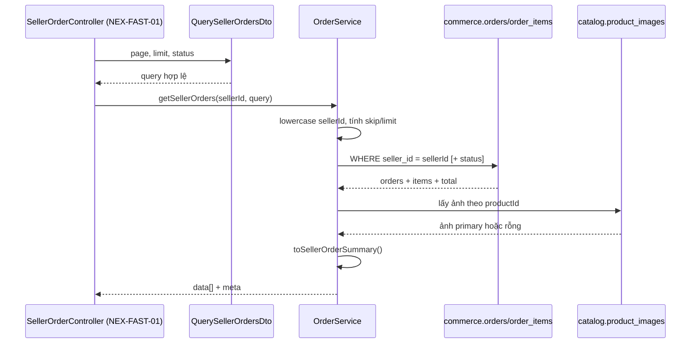
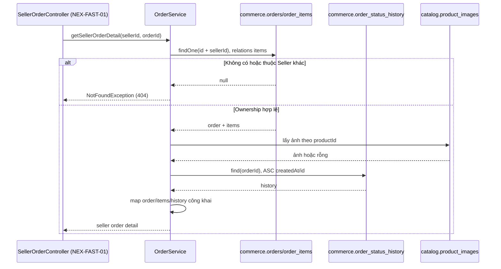

# NEX-FAST-02 — Luồng danh sách và chi tiết đơn hàng của Seller

## 1. Mục đích tài liệu

Tài liệu này mô tả phần backend đã triển khai cho NEX-FAST-02 theo thứ tự từ điểm bắt đầu đến điểm kết thúc của từng luồng. Phạm vi hiện tại là tầng DTO, service truy vấn và unit test. HTTP controller, guard và route `/api/v1/commerce/seller/orders` thuộc NEX-FAST-01 nên chưa nằm trong thay đổi này.

Commit triển khai: `a5800c5f48d316afb335ee2e8926d77c472f1bbf`.

## 2. Bản đồ mã nguồn

| Thành phần       | Đường dẫn                                                             |      Dòng | Vai trò                                                                                   |
| ---------------- | --------------------------------------------------------------------- | --------: | ----------------------------------------------------------------------------------------- |
| Query DTO        | `src/modules/commerce/dtos/query-seller-orders.dto.ts`                |      5–31 | Khai báo trạng thái Seller được phép lọc; kiểm tra `page`, `limit`, `status`.             |
| List service     | `src/modules/commerce/services/order.service.ts`                      |   508–542 | Lấy danh sách đơn thuộc Seller, lọc trạng thái, phân trang, làm giàu ảnh và trả response. |
| Detail service   | `src/modules/commerce/services/order.service.ts`                      |   548–599 | Lấy một đơn thuộc Seller, đọc items/history, làm giàu ảnh và tạo response an toàn.        |
| Image enrichment | `src/modules/commerce/services/order.service.ts`                      |   777–808 | Lấy ảnh ưu tiên từ `catalog.product_images` theo `productId`.                             |
| List mapper      | `src/modules/commerce/services/order.service.ts`                      |   810–834 | Chuyển `OrderEntity` thành summary contract cho Seller Portal.                            |
| Snapshot helper  | `src/modules/commerce/services/order.service.ts`                      |   836–842 | Đọc chuỗi an toàn từ snapshot địa chỉ.                                                    |
| Order ownership  | `src/modules/commerce/domain/entities/order.entity.ts`                |     41–42 | `sellerId` là khóa sở hữu đơn hàng.                                                       |
| Address snapshot | `src/modules/commerce/domain/entities/order.entity.ts`                |     81–82 | Địa chỉ giao hàng được cố định tại thời điểm checkout.                                    |
| Order items      | `src/modules/commerce/domain/entities/order-item.entity.ts`           |     13–48 | Snapshot tên, biến thể SKU, giá, số lượng và thành tiền.                                  |
| Status history   | `src/modules/commerce/domain/entities/order-status-history.entity.ts` |     10–30 | Nguồn lịch sử chuyển trạng thái đơn.                                                      |
| Unit tests       | `src/modules/commerce/services/order.service.spec.ts`                 | 1040–1204 | Kiểm thử list, detail, ownership, mapping và DTO validation.                              |

## 3. Điểm bắt đầu chung

Sau khi NEX-FAST-01 được nối vào, controller sẽ lấy `sellerId` từ access token và gọi một trong hai hàm:

```ts
orderService.getSellerOrders(sellerId, query);
orderService.getSellerOrderDetail(sellerId, orderId);
```

Service không tin tưởng `sellerId` từ query/body. Giá trị này phải đến từ authentication context. Trong service, ID được chuyển về chữ thường trước khi truy vấn tại `order.service.ts:509` và `order.service.ts:552`.

## 4. Luồng A — Lấy danh sách đơn hàng của Seller

### 4.1. Điểm bắt đầu

Đầu vào dự kiến từ controller:

- `sellerId`: ID người dùng Seller lấy từ access token.
- `query.page`: trang cần đọc, mặc định `1`.
- `query.limit`: số đơn mỗi trang, mặc định `10`, tối đa `100`.
- `query.status`: bộ lọc trạng thái tùy chọn.

DTO tại `query-seller-orders.dto.ts:5–31` chỉ cho phép:

```text
PAID | PROCESSING | SHIPPED | DELIVERED | CANCELLED
```

`PENDING_PAYMENT` bị loại vì không nằm trong contract Seller Orders. Việc kiểm tra này diễn ra trước service khi controller dùng `QuerySellerOrdersDto` cùng global validation pipe.

### 4.2. Chuẩn hóa phân trang

Tại `order.service.ts:509–512`:

1. Chuyển `sellerId` về lowercase.
2. Ép `page` nhỏ nhất là `1`.
3. Ép `limit` vào khoảng `1..100`.
4. Tính `skip = (page - 1) * limit`.

DTO là hàng rào đầu tiên; phép ép trong service là hàng rào phòng vệ thứ hai khi service được gọi trực tiếp từ nội bộ.

### 4.3. Truy vấn ownership và items

Tại `order.service.ts:514–519`, service tạo query cho bảng `commerce.orders`, join `order.items`, sau đó áp điều kiện sở hữu:

```sql
WHERE order.seller_id = :sellerId
```

Đây là điểm bảo mật quan trọng nhất: đơn của Seller khác bị loại ngay trong database query, không được tải lên rồi mới lọc trong bộ nhớ.

Nếu có `status`, điều kiện được bổ sung tại `order.service.ts:521–523`:

```sql
AND order.status = :status
```

### 4.4. Sắp xếp và phân trang

Tại `order.service.ts:525–530`:

1. Sắp xếp `createdAt DESC` để đơn mới nhất đứng trước.
2. Sắp xếp phụ `id DESC` để thứ tự ổn định khi nhiều đơn có cùng thời gian tạo.
3. Áp dụng `skip` và `take`.
4. Gọi `getManyAndCount()` để lấy dữ liệu và tổng số bản ghi trong cùng contract phân trang.

### 4.5. Làm giàu ảnh sản phẩm

`enrichOrdersWithImages()` tại `order.service.ts:777–808` thực hiện:

1. Thu thập các `productId` duy nhất từ mọi item.
2. Query `catalog.product_images` tại `order.service.ts:790–796`.
3. Với mỗi sản phẩm, chọn ảnh primary trước, sau đó theo `sort_order` và `id`.
4. Gán URL vào thuộc tính runtime `item.imageUrl` và `item.primaryImageUrl`.
5. Nếu không tìm thấy ảnh, mapper trả `null`.

### 4.6. Mapping response danh sách

`toSellerOrderSummary()` tại `order.service.ts:810–834` chuyển dữ liệu persistence thành contract riêng:

| Response       | Nguồn                                                  |
| -------------- | ------------------------------------------------------ |
| `id`           | `order.id`                                             |
| `orderCode`    | `order.orderNumber`                                    |
| `status`       | `order.status`                                         |
| `subtotal`     | `order.subtotal`                                       |
| `shippingFee`  | `order.shippingFee`                                    |
| `totalAmount`  | `order.total`                                          |
| `currency`     | `order.currency`                                       |
| `buyerName`    | `shippingAddressSnapshot.recipientName`                |
| `buyerPhone`   | `shippingAddressSnapshot.recipientPhone`               |
| `itemCount`    | Tổng `quantity` của mọi dòng SKU                       |
| `itemsSummary` | Snapshot tên, thuộc tính SKU, đơn giá, số lượng và ảnh |
| `createdAt`    | `order.createdAt`                                      |

`buyerName` và `buyerPhone` thực chất dùng dữ liệu người nhận tại thời điểm checkout. Helper `snapshotString()` tại `order.service.ts:836–842` trả `null` nếu snapshot thiếu trường hoặc giá trị không phải chuỗi.

### 4.7. Điểm kết thúc

Service trả:

```json
{
  "data": [
    {
      "id": "order-uuid",
      "orderCode": "ORD-123456-TEST",
      "status": "PAID",
      "subtotal": "550000.00",
      "shippingFee": "30000.00",
      "totalAmount": "580000.00",
      "currency": "VND",
      "buyerName": "Nguyen Van A",
      "buyerPhone": "0987654321",
      "itemCount": 2,
      "itemsSummary": []
    }
  ],
  "meta": {
    "page": 1,
    "limit": 10,
    "total": 1,
    "totalPages": 1
  }
}
```

`totalPages` được tính tại `order.service.ts:535–539` và có giá trị tối thiểu `1`, đồng bộ với convention Buyer Orders hiện tại.

### 4.8. Sơ đồ luồng danh sách



## 5. Luồng B — Lấy chi tiết một đơn hàng

### 5.1. Điểm bắt đầu

Đầu vào:

- `sellerId`: lấy từ access token.
- `orderId`: UUID lấy từ route parameter và cần được controller kiểm tra bằng `ParseUUIDPipe` khi NEX-FAST-01 được triển khai.

Điểm gọi service là `getSellerOrderDetail()` tại `order.service.ts:548`.

### 5.2. Kiểm tra quyền sở hữu ngay trong truy vấn

Tại `order.service.ts:549–555`, điều kiện tìm đơn gồm đồng thời:

```ts
where: {
  id: orderId,
  sellerId: sellerId.toLowerCase(),
}
```

Query chỉ thành công khi cả ID đơn và chủ sở hữu đều đúng. Service không tìm đơn chỉ bằng `orderId` rồi mới so sánh seller, nhờ đó giảm nguy cơ rò rỉ dữ liệu.

### 5.3. Luồng lỗi không tồn tại hoặc không thuộc quyền

Nếu repository trả `null`, service ném `NotFoundException` tại `order.service.ts:557–559`.

Cả hai trường hợp sau đều có cùng kết quả `404`:

- `orderId` không tồn tại.
- `orderId` tồn tại nhưng thuộc Seller khác.

Thiết kế này không xác nhận sự tồn tại của tài nguyên cho người không có quyền, hạn chế dò ID đơn hàng.

### 5.4. Làm giàu items và đọc history

Khi ownership hợp lệ:

1. `order.service.ts:561` gọi `enrichOrdersWithImages([order])`.
2. `order.service.ts:562–565` đọc `order_status_history` theo `orderId`.
3. History được sắp xếp `createdAt ASC`, rồi `id ASC`, nghĩa là từ sự kiện cũ nhất tới mới nhất và ổn định khi trùng timestamp.

### 5.5. Mapping response chi tiết

Response được tạo rõ ràng tại `order.service.ts:567–598`; service không spread trực tiếp `OrderEntity`.

Thông tin đơn gồm:

- Mã và trạng thái: `id`, `orderCode`, `status`.
- Tài chính: `subtotal`, `shippingFee`, `discountAmount`, `tax`, `totalAmount`, `currency`.
- Địa chỉ: toàn bộ `shippingAddressSnapshot` đã cố định khi checkout.
- Thời gian: `createdAt`, `updatedAt`.

Mỗi item tại `order.service.ts:578–589` gồm:

- `id`, `productId`, `skuId`.
- `productNameSnapshot`, `skuAttributesSnapshot`.
- `unitPrice`, `quantity`, `discountAmount`, `lineTotal`.
- `imageUrl`, trả `null` nếu không có ảnh.

Mỗi history entry tại `order.service.ts:590–595` chỉ gồm:

- `fromStatus`.
- `toStatus`.
- `reason`.
- `createdAt`.

Các trường persistence nội bộ `orderId` và `changedBy` không được trả cho Seller. Đây là kết quả sửa sau vòng review độc lập để giữ contract seller-safe.

### 5.6. Điểm kết thúc

Service trả một object chi tiết sẵn sàng để controller bọc trong response envelope:

```json
{
  "id": "order-uuid",
  "orderCode": "ORD-123456-TEST",
  "status": "PAID",
  "subtotal": "550000.00",
  "shippingFee": "30000.00",
  "discountAmount": "0.00",
  "tax": "0.00",
  "totalAmount": "580000.00",
  "currency": "VND",
  "shippingAddress": {},
  "items": [],
  "history": [],
  "createdAt": "2026-11-03T08:30:00.000Z",
  "updatedAt": "2026-11-03T08:45:00.000Z"
}
```

### 5.7. Sơ đồ luồng chi tiết



## 6. Luồng kiểm thử

Test suite bắt đầu tại `order.service.spec.ts:1040`.

### 6.1. Danh sách, ownership, filter và mapping

Test tại `order.service.spec.ts:1075–1129` xác nhận:

- `sellerId` uppercase được chuẩn hóa thành lowercase.
- Query luôn có `order.sellerId = :sellerId`.
- Filter `PAID` được đưa vào SQL.
- Trang 2 với limit 10 tạo `skip = 10`.
- Metadata trả `total` và `totalPages` đúng.
- `orderNumber` được map thành `orderCode`.
- `total` được map thành `totalAmount`.
- `itemCount` là tổng quantity.
- Ảnh sản phẩm được đưa vào `itemsSummary`.

### 6.2. Chi tiết, snapshot thiếu trường, ảnh null và history an toàn

Test tại `order.service.spec.ts:1131–1180` xác nhận:

- Repository nhận đồng thời `orderId` và `sellerId`.
- Snapshot địa chỉ thiếu trường vẫn được trả mà không gây lỗi.
- Không có ảnh thì `imageUrl` là `null`.
- History được yêu cầu theo thứ tự tăng dần.
- Response history không chứa `orderId` và `changedBy`.

### 6.3. Chống đọc đơn của Seller khác

Test tại `order.service.spec.ts:1182–1190` giả lập repository trả `null` cho đơn không thuộc quyền và xác nhận:

- Service ném `NotFoundException`.
- Không query history sau khi ownership thất bại.

### 6.4. Validation trạng thái

Test tại `order.service.spec.ts:1192–1203` truyền `PENDING_PAYMENT` và xác nhận DTO phát sinh validation error tại thuộc tính `status`.

## 7. Kết quả xác minh

Các lệnh đã chạy thành công cho thay đổi này:

```text
npx vitest run src/modules/commerce/services/order.service.spec.ts
29/29 tests passed

npm test
776/776 tests passed

npm run typecheck
passed

npm run lint
passed

npm run build
passed
```

Bộ e2e toàn repository đạt `211/214`. Ba lỗi còn lại không thuộc NEX-FAST-02: hai test Seller Product thiếu provider mock `SellerBulkImportService`, và một startup test timeout do Redis tại `localhost:6379` không chạy.

## 8. Điểm tích hợp còn lại với NEX-FAST-01

Để biến service thành HTTP API có thể gọi từ frontend/Postman, NEX-FAST-01 cần:

1. Tạo `SellerOrderController`.
2. Gắn `AccessTokenGuard` và guard phân quyền Seller theo convention hiện tại.
3. Lấy `sellerId` từ authentication context, không nhận từ client.
4. Dùng `QuerySellerOrdersDto` cho route danh sách.
5. Dùng `ParseUUIDPipe` cho `:id`.
6. Gọi hai service method đã triển khai.
7. Bọc kết quả bằng response envelope chuẩn.

Các route mục tiêu:

```text
GET /api/v1/commerce/seller/orders
GET /api/v1/commerce/seller/orders/:id
```

Khi controller được thêm, cần bổ sung e2e/Supertest cho `401`, quyền Seller, list thành công, detail thành công và truy cập chéo Seller trả `404`.
