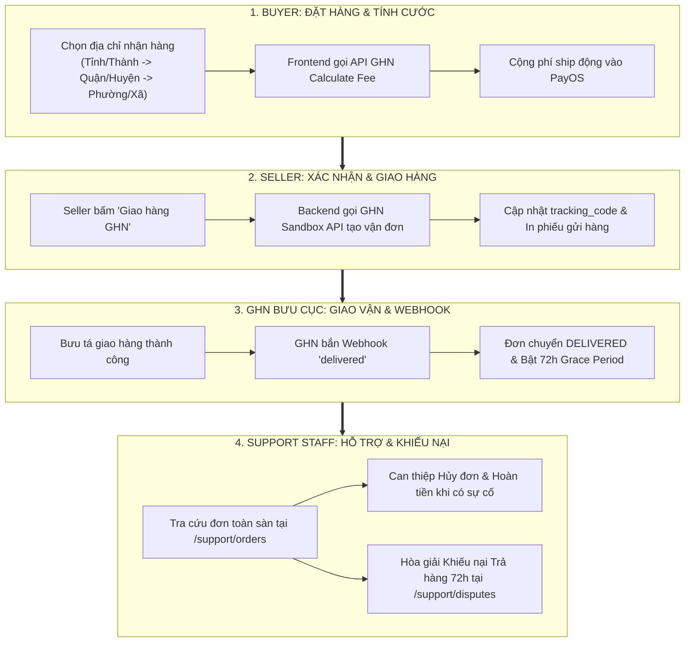
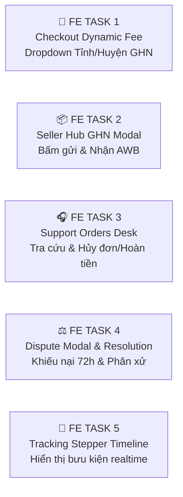

# KẾ HOẠCH TRIỂN KHAI & PHÂN CÔNG NHIỆM VỤ CHI TIẾT (FULLSTACK)

## SPRINT FAST: TÍCH HỢP GIAO HÀNG NHANH (GHN LOGISTICS) & PHÂN HỆ SUPPORT STAFF

### MỤC TIÊU BẢN GIAO: DEMO HOÀN CHỈNH SÁNG THỨ HAI (09/11/2026)

> **Phương pháp luận:** BMAD Method (Vertical Slicing Engineering + Bounded Context Architecture)  
> **Phạm vi dự án:** Cả **Backend NestJS** và **Frontend React 19 + Vite + Tailwind**  
> **Người lập kế hoạch:** Dev 1 (Minh - Tech Lead)  
> **Tài liệu tham chiếu:** `docs/business-rules-nexus.md` (BR-02, BR-03, BR-07), `frontend/src/constants/routes.ts`, `frontend/src/constants/staff.ts`

---

## 🗺️ TỔNG QUAN LUỒNG KẾT NỐI FULLSTACK (END-TO-END FLOW)

---

## 📊 BẢNG TỔNG HỢP MA TRẬN PHÂN CÔNG NHIỆM VỤ (MASTER ASSIGNMENT TABLE)

|   Mã Task   | Thành viên phụ trách |    Phân hệ / Module    | Nội dung công việc chi tiết                                                                        | Deliverable (File chính)                                                                                  | API Endpoint / Route UI                                                               |      Hạn chót      |
| :---------: | :------------------- | :--------------------: | -------------------------------------------------------------------------------------------------- | --------------------------------------------------------------------------------------------------------- | ------------------------------------------------------------------------------------- | :----------------: |
| **[BE-01]** | **Minh (Tech Lead)** |   **GHN Logistics**    | Cấu hình Client kết nối GHN Express Sandbox API (`/v2/shipping-order/create`)                      | `src/modules/fulfillment/services/ghn-client.service.ts`                                                  | Backend Service (Internal)                                                            |  **Thứ 6 (20h)**   |
| **[BE-02]** | **Minh (Tech Lead)** |   **GHN Logistics**    | API cho Seller bấm "Giao hàng GHN" tự động sinh mã vận đơn thật lưu vào đơn hàng                   | `src/modules/fulfillment/controllers/seller-inventory.controller.ts`                                      | `POST /api/v1/fulfillment/seller/orders/:id/ghn-ship`                                 |  **Thứ 7 (12h)**   |
| **[BE-03]** | **Minh (Tech Lead)** |   **GHN Logistics**    | Webhook nhận cập nhật `delivered` từ bưu tá, chống trùng lặp, chuyển đơn sang `DELIVERED`          | `src/modules/fulfillment/controllers/shipping-webhook.controller.ts`                                      | `POST /api/v1/fulfillment/shipping/ghn-webhook`                                       |  **Thứ 7 (18h)**   |
| **[BE-04]** | **Minh (Tech Lead)** |   **Core & Quality**   | Quản lý nhánh Git, Review Merge Request, kiểm tra chất lượng (0 lỗi typecheck/lint)                | Git branches, Merge Requests                                                                              | Nhánh `main`                                                                          | **Chủ nhật (17h)** |
| **[BE-05]** | **Hoàng**            |   **GHN Logistics**    | API lấy danh mục Tỉnh/Thành $\rightarrow$ Quận/Huyện $\rightarrow$ Phường/Xã chuẩn GHN (kèm Cache) | `src/modules/fulfillment/controllers/shipping-locations.controller.ts`                                    | `GET /api/v1/fulfillment/shipping/locations/districts` `GET /locations/wards`     |  **Thứ 6 (22h)**   |
| **[BE-06]** | **Hoàng**            |   **GHN Logistics**    | API tính cước phí giao hàng động theo địa chỉ người nhận và trọng lượng bưu kiện                   | `src/modules/fulfillment/dtos/calculate-shipping-fee.dto.ts`                                              | `POST /api/v1/fulfillment/shipping/calculate-fee`                                     |  **Thứ 7 (12h)**   |
| **[BE-07]** | **Hoàng**            |   **Checkout Flow**    | Tích hợp cước phí động GHN vào tổng tiền thanh toán đơn hàng PayOS                                 | `src/modules/commerce/services/order.service.ts`                                                          | `POST /api/v1/commerce/orders/checkout`                                               |  **Thứ 7 (18h)**   |
| **[BE-08]** | **Khoa**             |   **Support Staff**    | API tra cứu đơn hàng toàn sàn (hỗ trợ search theo mã `orderCode`, SĐT, Email người mua)            | `src/modules/commerce/controllers/support-order.controller.ts`                                            | `GET /api/v1/commerce/support/orders` `GET /api/v1/commerce/support/orders/:id`   |  **Thứ 7 (12h)**   |
| **[BE-09]** | **Khoa**             |   **Support Staff**    | API Staff can thiệp hủy đơn hàng lỗi (`ORDER.CANCEL_OVERRIDE`), tự động hoàn trả tồn kho về kệ     | `src/modules/commerce/services/support-order.service.ts`                                                  | `POST /api/v1/commerce/support/orders/:id/cancel`                                     |  **Thứ 7 (17h)**   |
| **[BE-10]** | **Khoa**             |   **Support Staff**    | API Staff phát lệnh hoàn tiền giao dịch thẻ (`ORDER.REFUND_OVERRIDE`)                              | `src/modules/commerce/services/support-order.service.ts`                                                  | `POST /api/v1/commerce/support/orders/:id/refund`                                     |  **Thứ 7 (21h)**   |
| **[BE-11]** | **Duy**              | **Dispute Mediation**  | Tạo Database Migration & Entity `commerce.order_disputes` lưu hồ sơ khiếu nại                      | `src/database/migrations/xxx-CreateOrderDisputes.ts` `order-dispute.entity.ts`                        | PostgreSQL DB Table                                                                   |  **Thứ 6 (23h)**   |
| **[BE-12]** | **Duy**              | **Dispute Mediation**  | API cho Buyer gửi khiếu nại trong 72h và API cho Staff xem danh sách / phán quyết hoàn tiền        | `src/modules/commerce/controllers/support-dispute.controller.ts`                                          | `POST /api/v1/commerce/orders/:id/disputes` `PATCH /support/disputes/:id/resolve` |  **Thứ 7 (18h)**   |
| **[BE-13]** | **Duy**              | **Security & Testing** | Cấu hình RBAC Guards cho Staff và viết bộ Unit/E2E test suite kiểm tra bảo mật                     | `src/modules/commerce/controllers/support-order.security.spec.ts`                                         | Test Suite Vitest                                                                     | **Chủ nhật (12h)** |
| **[FE-01]** | **Team Frontend**    |    **Checkout UI**     | Tích hợp 3 dropdown Tỉnh/Quận/Phường GHN, tự động gọi API tính cước và cộng vào PayOS              | `frontend/src/pages/checkout/CheckoutPage.tsx`                                                            | Trang `/checkout`                                                                     |  **Thứ 7 (15h)**   |
| **[FE-02]** | **Team Frontend**    |   **Seller Hub UI**    | Thêm nút "Giao hàng GHN" & Modal xác nhận gửi bưu cục, hiển thị mã vận đơn chuẩn AWB               | `frontend/src/components/seller/ShipOrderModal.tsx`                                                       | Trang `/seller/orders`                                                                |  **Thứ 7 (18h)**   |
| **[FE-03]** | **Team Frontend**    |  **Support Desk UI**   | Dựng trang tra cứu đơn toàn sàn, xem chi tiết và Modal can thiệp Hủy đơn/Hoàn tiền                 | `frontend/src/pages/support/SupportOrdersPage.tsx` `SupportOrderDetailPage.tsx`                       | Route `/support/orders`                                                               |  **Thứ 7 (21h)**   |
| **[FE-04]** | **Team Frontend**    |     **Dispute UI**     | Form gửi khiếu nại kèm upload ảnh cho Buyer; Màn hình xem bằng chứng và duyệt phán quyết cho Staff | `frontend/src/pages/account/OrderDetailPage.tsx` `frontend/src/pages/support/SupportDisputesPage.tsx` | Route `/account/orders/:id` Route `/support/disputes`                             | **Chủ nhật (12h)** |
| **[FE-05]** | **Team Frontend**    |  **Tracking Stepper**  | Component thanh Stepper 5 bước trực quan hóa tiến độ giao hàng từ GHN                              | `frontend/src/components/orders/ShipmentCard.tsx`                                                         | Chi tiết đơn Buyer & Seller                                                           | **Chủ nhật (15h)** |

---

## 👥 PHẦN 1: PHÂN CÔNG CHI TIẾT CHO TEAM BACKEND (4 THÀNH VIÊN)

### 👤 1. DEV 1: Minh (Tech Lead & Backend Core)

- **Trọng tâm:** Kết nối cốt lõi GHN API Sandbox, Webhook Idempotency, Quản lý Nhánh & Tích hợp Main.
- **Chi tiết các Task:**
  1. **Task [BE-GHN-01]: Tạo `GhnClientService` kết nối GHN Express Sandbox API:**
     - File: `src/modules/fulfillment/services/ghn-client.service.ts`.
     - Tích hợp endpoint GHN: `POST /shiip/public-api/v2/shipping-order/create`.
     - Đọc cấu hình từ `.env`: `GHN_API_URL`, `GHN_API_TOKEN`, `GHN_SHOP_ID`.
  2. **Task [BE-GHN-02]: API Seller kích hoạt tạo đơn bưu cục:**
     - File: `src/modules/fulfillment/controllers/seller-inventory.controller.ts` (hoặc mở rộng `seller-order.controller.ts`).
     - Endpoint: `POST /api/v1/fulfillment/seller/orders/:id/ghn-ship`.
     - Logic: Lấy địa chỉ Shop làm điểm gửi (Pick), địa chỉ Buyer làm điểm nhận $\rightarrow$ Gọi GHN $\rightarrow$ Nhận `order_code` GHN $\rightarrow$ Cập nhật vào `commerce.orders.tracking_code`, chuyển trạng thái `status = 'SHIPPED'`.
  3. **Task [BE-GHN-03]: Webhook tiếp nhận hành trình bưu cục (Idempotent Worker):**
     - File: `src/modules/fulfillment/controllers/shipping-webhook.controller.ts`.
     - Endpoint: `POST /api/v1/fulfillment/shipping/ghn-webhook`.
     - Logic: Xác thực secret token $\rightarrow$ Kiểm tra Idempotency chống bắn trùng lặp $\rightarrow$ Cập nhật đơn sang `DELIVERED`, lưu `delivered_at = NOW()` $\rightarrow$ Kích hoạt timer 72 giờ ký quỹ.
  4. **Task [BE-CORE-04]: Code Review, Hỗ trợ các Devs & Merge vào `main`:**
     - Duyệt Merge Request, chạy typecheck, linter và đảm bảo 100% test pass.

---

### 👤 2. DEV 3: Hoàng (Fulfillment & Checkout Logistics)

- **Trọng tâm:** Tính cước phí giao hàng động từ GHN & Đồng bộ danh mục địa giới hành chính.
- **Chi tiết các Task:**
  1. **Task [BE-LOC-01]: API Danh mục Địa giới chuẩn GHN:**
     - File: `src/modules/fulfillment/controllers/shipping-locations.controller.ts`.
     - Endpoint: `GET /api/v1/fulfillment/shipping/locations/districts?provinceId=...` (Lấy danh sách Quận/Huyện).
     - Endpoint: `GET /api/v1/fulfillment/shipping/locations/wards?districtId=...` (Lấy danh sách Phường/Xã).
     - Caching Redis để tối ưu tốc độ phản hồi cho Frontend.
  2. **Task [BE-FEE-02]: API Tính cước phí giao hàng động:**
     - Endpoint: `POST /api/v1/fulfillment/shipping/calculate-fee`.
     - DTO `CalculateShippingFeeDto`: `toDistrictId`, `toWardCode`, `weightInGrams`.
     - Gọi GHN API `/shipping-order/fee`, trả về cước phí chuẩn (VND) và ngày giao dự kiến (`expected_delivery_time`).
  3. **Task [BE-FEE-03]: Tích hợp phí ship động vào Checkout Process Manager:**
     - File: `src/modules/commerce/services/order.service.ts`.
     - Đọc cước phí thực tế từ GHN và cộng vào `shipping_fee` trong đơn hàng PayOS thay vì dùng giá ship cố định.

---

### 👤 3. DEV 2: Khoa (Support Staff Orders & Inventory Recovery)

- **Trọng tâm:** Phân hệ Tra cứu đơn toàn sàn & Can thiệp Hủy đơn / Hoàn tiền khôi phục kho.
- **Chi tiết các Task:**
  1. **Task [BE-STF-01]: Controller & Service Tra cứu đơn dành cho Staff:**
     - File: `src/modules/commerce/controllers/support-order.controller.ts`.
     - Endpoint: `GET /api/v1/commerce/support/orders` (Yêu cầu quyền `ORDER.VIEW_ALL`).
     - Hỗ trợ tìm kiếm nhanh: Theo mã `orderCode` (ORD-xxx), Email người mua, Số điện thoại người nhận; Lọc theo trạng thái đơn.
     - Endpoint: `GET /api/v1/commerce/support/orders/:id`: Trả về chi tiết đơn, thông tin thanh toán, timeline bưu kiện và địa chỉ nhận hàng.
  2. **Task [BE-STF-02]: API Staff can thiệp Hủy đơn (`ORDER.CANCEL_OVERRIDE`):**
     - Endpoint: `POST /api/v1/commerce/support/orders/:id/cancel`.
     - DTO: `reason` (Lý do bắt buộc: "Hàng vỡ", "Thất lạc", "Khách đổi ý").
     - **Logic nguyên tử:** Đổi trạng thái sang `CANCELLED` và **gọi nhả tồn kho hoàn trả về kệ bán lẻ (`release reserved inventory`)** để không bị giam hàng của Seller.
  3. **Task [BE-STF-03]: API Staff phát lệnh Hoàn tiền (`ORDER.REFUND_OVERRIDE`):**
     - Endpoint: `POST /api/v1/commerce/support/orders/:id/refund`.
     - DTO: `amount`, `reason`.
     - Ghi nhận bản ghi hoàn tiền vào bảng `commerce.refunds`, cập nhật trạng thái đơn thành `REFUNDED`.

---

### 👤 4. DEV 4: Duy (Dispute Mediation & Security/Testing)

- **Trọng tâm:** Nghiệp vụ Tranh chấp (Khiếu nại 72h), Phân quyền RBAC & Bộ Test Suite.
- **Chi tiết các Task:**
  1. **Task [BE-DIS-01]: Migration & Entity Khiếu nại Đơn hàng:**
     - Tạo bảng `commerce.order_disputes`: `id`, `order_id`, `buyer_id`, `seller_id`, `reason_category`, `evidence_description`, `evidence_images`, `status`, `staff_decision_note`, `created_at`.
  2. **Task [BE-DIS-02]: APIs Xử lý Khiếu nại:**
     - `POST /api/v1/commerce/orders/:id/disputes`: Người mua gửi yêu cầu khiếu nại (chỉ cho phép trong vòng 72h kể từ lúc `DELIVERED`).
     - `GET /api/v1/commerce/support/disputes`: Staff xem danh sách các vụ tranh chấp đang chờ xử lý.
     - `PATCH /api/v1/commerce/support/disputes/:id/resolve`: Staff phán quyết (`ACCEPTED_REFUND` $\rightarrow$ Hoàn tiền Buyer, hoặc `REJECTED_PAY_SELLER` $\rightarrow$ Giải ngân cho Seller).
  3. **Task [BE-SEC-03]: Cấu hình RBAC Guards & Security Tests:**
     - Đăng ký mã quyền trong `rbac.constants.ts`: `ORDER.VIEW_ALL`, `ORDER.CANCEL_OVERRIDE`, `ORDER.REFUND_OVERRIDE`, `DISPUTE.MANAGE`.
     - Viết Unit test & E2E Security test: Chặn Buyer/Seller thường không thể truy cập API Support; Chặn Buyer khiếu nại đơn của người khác; Chặn khiếu nại quá hạn 72h.

---

## 💻 PHẦN 2: PHÂN CÔNG CHI TIẾT CHO TEAM FRONTEND (REACT + VITE)

Đội ngũ Frontend dựa trên khung giao diện có sẵn ([StaffLayout.tsx](file:///d:/Dev/Learning/NESTJS-SERiES/Nexus-e-commerce/frontend/src/components/layout/StaffLayout.tsx) và [routes.ts](file:///d:/Dev/Learning/NESTJS-SERiES/Nexus-e-commerce/frontend/src/constants/routes.ts)) để triển khai các màn hình sau:

---

### 🖥️ FE TASK 1: Chọn Địa Chỉ & Tính Cước Phí GHN Tự Động tại Checkout

- **Trang áp dụng:** `frontend/src/pages/checkout/CheckoutPage.tsx`.
- **Mô tả công việc:**
  1. Thay thế ô nhập địa chỉ tự do bằng 3 dropdown liên hoàn: **Tỉnh/Thành phố** $\rightarrow$ **Quận/Huyện** $\rightarrow$ **Phường/Xã** (dữ liệu lấy từ API Backend GHN Locations).
  2. Khi người mua chọn đủ 3 cấp địa chỉ, trigger gọi API `POST /api/v1/fulfillment/shipping/calculate-fee`.
  3. Hiển thị dòng **Phí vận chuyển GHN** trong bảng tóm tắt đơn hàng (Summary Card) và tự động cộng vào tổng tiền thanh toán PayOS.

---

### 🖥️ FE TASK 2: Modal Giao Hàng GHN trong Kênh Người Bán (Seller Hub)

- **Trang áp dụng:** `frontend/src/pages/seller/SellerOrdersPage.tsx` & `frontend/src/components/seller/ShipOrderModal.tsx`.
- **Mô tả công việc:**
  1. Trong bảng đơn hàng của Seller, ở nút hành động của đơn `PAID` / `PROCESSING`, bổ sung nút **"Giao hàng bưu cục GHN"**.
  2. Bấm vào mở `ShipOrderModal`: Hiển thị thông tin người nhận, trọng lượng kiện hàng, và nút **"Xác nhận tạo vận đơn"**.
  3. Sau khi gọi API thành công:
     - Hiển thị mã vận đơn chuẩn GHN (VD: `GHN-839210`) kèm nút sao chép nhanh.
     - Cung cấp nút **"In phiếu gửi hàng (AWB)"** mở link in mã vạch.
     - Cập nhật badge trạng thái đơn hàng sang màu xanh lam `SHIPPED`.

---

### 🖥️ FE TASK 3: Màn Hình Tra Cứu Đơn Hàng Dành Cho Support Staff

- **Trang áp dụng:** `frontend/src/pages/support/SupportOrdersPage.tsx` & `SupportOrderDetailPage.tsx` (sử dụng `StaffLayout.tsx`).
- **Mô tả công việc:**
  1. **Thanh tìm kiếm nâng cao:** Ô Search tìm theo mã đơn `ORD-xxx`, Email hoặc SĐT; Dropdown lọc theo trạng thái đơn hàng (`ALL`, `PROCESSING`, `SHIPPED`, `DELIVERED`, `CANCELLED`).
  2. **Bảng danh sách đơn toàn sàn:** Cột mã đơn, người mua, shop bán, tổng tiền, trạng thái, thời gian đặt, nút "Xem chi tiết".
  3. **Trang chi tiết & Thao tác can thiệp:**
     - Nút **"Hủy đơn hàng khẩn cấp"**: Mở Modal nhập lý do hủy $\rightarrow$ Gọi API hủy đơn và thông báo hoàn kho thành công.
     - Nút **"Hoàn tiền giao dịch"**: Mở Modal nhập số tiền hoàn và lý do $\rightarrow$ Gọi API hoàn tiền.

---

### 🖥️ FE TASK 4: Luồng Khiếu Nại Của Buyer & Phán Quyết Của Staff

- **Trang áp dụng:**
  - Buyer: `frontend/src/pages/account/OrderDetailPage.tsx`.
  - Staff: `frontend/src/pages/support/SupportDisputesPage.tsx`.
- **Mô tả công việc:**
  1. **Phía Buyer (Khách hàng):**
     - Trong trang chi tiết đơn hàng của khách, nếu đơn ở trạng thái `DELIVERED` và chưa quá 72 giờ $\rightarrow$ Hiển thị nút **"Yêu cầu Trả hàng / Khiếu nại"**.
     - Bấm vào mở Form: Chọn lý do (Hàng vỡ, sai mẫu, hàng giả...), nhập mô tả và upload ảnh chụp kiện hàng lỗi.
  2. **Phía Support Staff (Nhân viên phân xử):**
     - Màn hình `/support/disputes`: Danh sách các vụ tranh chấp đang chờ xử lý.
     - Xem hồ sơ bằng chứng ảnh do Buyer gửi $\rightarrow$ Bấm nút **"Chấp thuận hoàn tiền"** hoặc **"Bác bỏ - Giải ngân cho Shop"**.

---

### 🖥️ FE TASK 5: Stepper Lộ Trình Bưu Kiện (Tracking Timeline)

- **Component:** `frontend/src/components/orders/ShipmentCard.tsx`.
- **Mô tả công việc:**
  - Hiển thị thanh tiến trình 5 bước trực quan trên cả trang của Buyer và Seller:
    - `1. Đã đặt hàng` $\rightarrow$ `2. Đã thanh toán` $\rightarrow$ `3. Đang chuẩn bị` $\rightarrow$ `4. Đang giao hàng (GHN)` $\rightarrow$ `5. Giao thành công`.
  - Hiển thị logo GHN Express, mã vận đơn có nút copy và thời gian cập nhật trạng thái gần nhất.

---

## 📅 PHẦN 3: TIMELINE TRIỂN KHAI TỪ THỨ SÁU ĐẾN CHỦ NHẬT

| Thời gian               | Backend Deliverables                                                                                                                                          | Frontend Deliverables                                                                                      | Mục tiêu kiểm thử                                                     |
| ----------------------- | ------------------------------------------------------------------------------------------------------------------------------------------------------------- | ---------------------------------------------------------------------------------------------------------- | --------------------------------------------------------------------- |
| **Thứ Sáu (Hôm nay)**   | • Minh tạo cấu hình GHN Sandbox `.env`. • Hoàng làm API Locations & Fee. • Khoa dựng `SupportOrderController`. • Duy tạo entity `order_disputes`. | • Tích hợp dropdown địa chỉ GHN vào Checkout. • Dựng khung trang `SupportOrdersPage`.                  | Pass typecheck, test gọi API tính phí ship GHN thành công.            |
| **Thứ Bảy (Cày chính)** | • Minh hoàn thiện `ghn-ship` & Webhook. • Khoa hoàn thiện Cancel/Refund. • Duy xong APIs Dispute & RBAC test.                                         | • Tích hợp Modal "Giao hàng GHN" của Seller. • Hoàn thiện màn hình tra cứu Support Orders & Khiếu nại. | Test luồng Seller tạo đơn bưu cục $\rightarrow$ Nhận mã vận đơn thật. |
| **Chủ Nhật (Tích hợp)** | • Minh gom Merge Request vào `main`. • Chạy full test suite (`826+ tests`).                                                                               | • Kết nối trọn vẹn FE với BE trên `main`. • Kiểm tra responsive & hiển thị toast.                      | Diễn tập chạy thử kịch bản demo 3 bước không phát sinh lỗi.           |
| **Thứ Hai (Sáng)**      | **SẴN SÀNG 100% LÊN DEMO TRƯỚC HỘI ĐỒNG / GIẢNG VIÊN!**                                                                                                       |                                                                                                            |                                                                       |

---

## 🏆 KỊCH BẢN NÓI KHI THUYẾT TRÌNH DEMO THỨ HAI

> _"Chào thầy cô và các bạn. Sau khi hoàn thành luồng bán lẻ cốt lõi, hôm nay nhóm em xin trình diễn **2 phân hệ hoàn thiện chu trình vận hành TMĐT chuyên nghiệp**: **Giao vận tự động với GHN Express** và **Phân hệ Support Staff xử lý sự cố & khiếu nại**:_
>
> 1. _Đầu tiên, khi khách hàng chọn địa chỉ giao hàng tại bước Checkout, hệ thống kết nối API GHN Sandbox để **tính cước phí động** theo khoảng cách và trọng lượng bưu kiện._
> 2. _Thứ hai, tại kênh Người bán, khi đơn hàng sẵn sàng, Seller chỉ cần 1 click để **kết nối bưu tá GHN lấy hàng, tự động nhận mã vận đơn AWB thật** và theo dõi lộ trình thời gian thực._
> 3. _Cuối cùng, nhóm em demo vai trò **Support Staff**: Nhân viên CSKH sử dụng giao diện Support Desk tra cứu đơn hàng toàn sàn, can thiệp hủy đơn lỗi và **phân xử khiếu nại trả hàng/hoàn tiền trong thời hạn bảo vệ 72 giờ**, đảm bảo sự an tâm tuyệt đối cho người tiêu dùng."_
