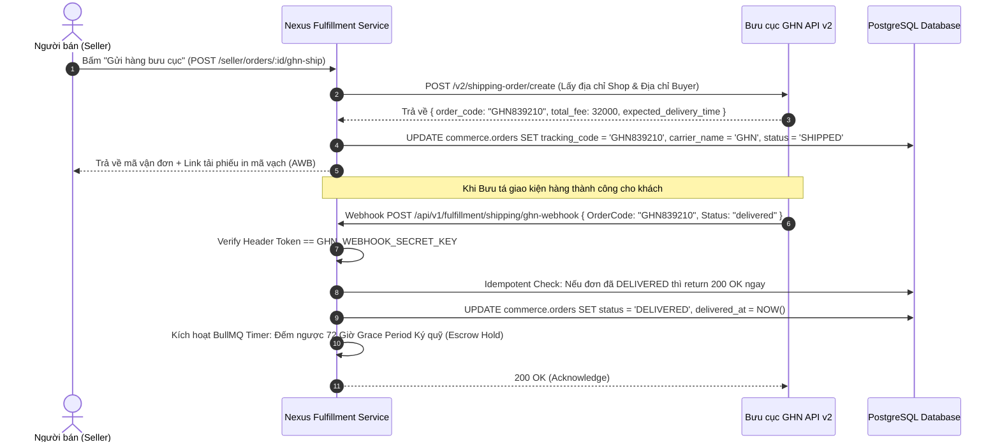

# ĐẶC TẢ KỸ THUẬT TRIỂN KHAI VERTICAL SLICES (BMAD METHOD - DEEP SPEC)

## HỆ THỐNG: ĐIỂM UY TÍN, GIAO HÀNG TỰ ĐỘNG, SUPPORT STAFF, LIVE CHAT & AI ASSISTANT

### DỰ ÁN: NEXUS E-COMMERCE & REALTIME AUCTION PLATFORM

> **Phương pháp luận:** BMAD Method (Bounded Context + Vertical Slicing Engineering + Test-Driven DoD)  
> **Phiên bản:** 2.0 (Deep Technical Specification)  
> **Tài liệu quy chuẩn tham chiếu:** `docs/business-rules-nexus.md` (BR-02, BR-03, BR-07), `src/modules/identity/rbac/rbac.constants.ts`  
> **Trạng thái nền tảng:** Đã tích hợp hoàn thiện Core Retail (Auth, Catalog 3 cấp, Supabase Media Storage, Cart, PayOS, Seller Hub, Admin Console).

---

## 🗺️ TỔNG QUAN KIẾN TRÚC 5 VERTICAL SLICES

```mermaid
flowchart TD
    subgraph S1["⭐ SLICE 1: REPUTATION ENGINE (BR-02)"]
        direction TB
        R_DB[("identity.reputation_scores<br/>identity.reputation_history<br/>commerce.order_ratings")]
        R_SVC["ReputationService<br/>• Calculate Delta & Trust Level<br/>• Idempotent Lock: SELECT FOR UPDATE"]
        R_API["GET /api/v1/identity/users/me/reputation<br/>POST /api/v1/commerce/orders/:id/rate"]
        R_DB --- R_SVC --- R_API
    end

    subgraph S2["🚚 SLICE 2: LOGISTICS (GHN EXPRESS API)"]
        direction TB
        G_SVC["GhnClientService (Sandbox)<br/>• Dynamic Fee Calculator<br/>• Auto-Generate AWB Tracking"]
        G_WEBHOOK["POST /api/v1/fulfillment/shipping/ghn-webhook<br/>• Idempotency Check<br/>• Auto DELIVERED -> Trigger 72h Escrow"]
        G_SVC --- G_WEBHOOK
    end

    subgraph S3["🎧 SLICE 3: SUPPORT STAFF DESK"]
        direction TB
        S_SVC["SupportOrderService & DisputeService<br/>• Global Search Regex<br/>• Atomic Refund & Cancel with Inventory Return"]
        S_API["GET /api/v1/commerce/support/orders<br/>POST /:id/cancel | POST /:id/refund<br/>PATCH /support/disputes/:id/resolve"]
        S_SVC --- S_API
    end

    subgraph S4["💬 SLICE 4: REALTIME LIVE CHAT"]
        direction TB
        C_GW["ChatGateway (@WebSocketGateway('/chat'))<br/>• JWT Handshake Auth<br/>• Room: conversation:{id}"]
        C_DB[("chat.conversations<br/>chat.messages")]
        C_GW --- C_DB
    end

    subgraph S5["🤖 SLICE 5: GEMINI AI ECOSYSTEM"]
        direction TB
        AI_SVC["GeminiService (Gemini 2.0 Flash)<br/>• System Prompt Context<br/>• Function Calling Tools (search_products, track_order)"]
        AI_HANDOVER["Sentiment Trigger<br/>• Escalate to Support Staff Room"]
        AI_SVC --- AI_HANDOVER
    end

    S1 ==> S2 ==> S3 ==> S4 ==> S5
```



---

## ⭐ VERTICAL SLICE 1: ĐỘNG CƠ ĐIỂM UY TÍN & ĐÁNH GIÁ 2 CHIỀU (REPUTATION ENGINE)

### 1.1. Chi tiết Database Schema & Migrations

Tạo migration `CreateReputationAndRatings.ts`:

```sql
-- 1. Bảng lưu điểm uy tín hiện tại của User
CREATE TABLE identity.reputation_scores (
    user_id UUID PRIMARY KEY REFERENCES identity.users(id) ON DELETE CASCADE,
    score INT NOT NULL DEFAULT 50 CONSTRAINT CHK_reputation_range CHECK (score >= 0 AND score <= 100),
    trust_level VARCHAR(20) NOT NULL DEFAULT 'STANDARD'
        CONSTRAINT CHK_reputation_trust_level CHECK (trust_level IN ('VIP', 'TRUSTED', 'STANDARD', 'RESTRICTED', 'UNTRUSTED')),
    completed_orders_this_month INT NOT NULL DEFAULT 0,
    month_period VARCHAR(7) NOT NULL DEFAULT TO_CHAR(NOW(), 'YYYY-MM'),
    created_at TIMESTAMPTZ NOT NULL DEFAULT NOW(),
    updated_at TIMESTAMPTZ NOT NULL DEFAULT NOW()
);

-- 2. Sổ cái biến động điểm bất biến (Append-Only Audit Ledger)
CREATE TABLE identity.reputation_history (
    id UUID PRIMARY KEY DEFAULT gen_random_uuid(),
    user_id UUID NOT NULL REFERENCES identity.users(id) ON DELETE CASCADE,
    delta INT NOT NULL,
    score_before INT NOT NULL,
    score_after INT NOT NULL,
    reason_code VARCHAR(50) NOT NULL,
    note TEXT,
    order_id UUID REFERENCES commerce.orders(id) ON DELETE SET NULL,
    created_at TIMESTAMPTZ NOT NULL DEFAULT NOW()
);
CREATE INDEX IDX_reputation_history_user_created ON identity.reputation_history (user_id, created_at DESC);

-- 3. Bảng quyền đánh giá (Eligibility Gate) & Đánh giá 2 chiều
CREATE TABLE commerce.order_ratings (
    id UUID PRIMARY KEY DEFAULT gen_random_uuid(),
    order_id UUID NOT NULL REFERENCES commerce.orders(id) ON DELETE RESTRICT,
    reviewer_id UUID NOT NULL REFERENCES identity.users(id) ON DELETE RESTRICT,
    reviewee_id UUID NOT NULL REFERENCES identity.users(id) ON DELETE RESTRICT,
    target_role VARCHAR(10) NOT NULL CHECK (target_role IN ('SELLER', 'BUYER')),
    stars INT NOT NULL CHECK (stars >= 1 AND stars <= 5),
    comment TEXT,
    images JSONB DEFAULT '[]'::jsonb,
    is_expired BOOLEAN NOT NULL DEFAULT FALSE,
    eligible_until TIMESTAMPTZ NOT NULL,
    created_at TIMESTAMPTZ NOT NULL DEFAULT NOW(),
    CONSTRAINT UQ_order_reviewer_role UNIQUE (order_id, reviewer_id, target_role)
);
CREATE INDEX IDX_order_ratings_reviewee ON commerce.order_ratings (reviewee_id, stars);
```

### 1.2. Logic Tính toán & Phân Cấp Cố Định (Invariant Rules)

```typescript
export function computeTrustLevel(
  score: number,
): 'VIP' | 'TRUSTED' | 'STANDARD' | 'RESTRICTED' | 'UNTRUSTED' {
  if (score >= 90) return 'VIP';
  if (score >= 80) return 'TRUSTED';
  if (score >= 50) return 'STANDARD';
  if (score >= 30) return 'RESTRICTED';
  return 'UNTRUSTED';
}
```

### 1.3. Concurrency & Khóa An toàn (Safe Delta Update)

Để tránh Race Condition khi có nhiều sự kiện cộng/trừ điểm xảy ra đồng thời:

```typescript
// Sử dụng QueryRunner với Pessimistic Lock
await queryRunner.startTransaction();
try {
  const repRecord = await queryRunner.manager
    .createQueryBuilder(ReputationScoreEntity, 'rep')
    .setLock('pessimistic_write')
    .where('rep.user_id = :userId', { userId })
    .getOne();

  const newScore = Math.max(0, Math.min(100, repRecord.score + delta));
  const newLevel = computeTrustLevel(newScore);

  await queryRunner.manager.update(
    ReputationScoreEntity,
    { userId },
    {
      score: newScore,
      trustLevel: newLevel,
      updatedAt: new Date(),
    },
  );

  await queryRunner.manager.insert(ReputationHistoryEntity, {
    userId,
    delta,
    scoreBefore: repRecord.score,
    scoreAfter: newScore,
    reasonCode,
    orderId,
  });

  await queryRunner.commitTransaction();
} catch (error) {
  await queryRunner.rollbackTransaction();
  throw error;
}
```

### 1.4. DTOs & Validation

```typescript
// src/modules/commerce/dtos/create-order-rating.dto.ts
export class CreateOrderRatingDto {
  @IsInt({ message: 'Số sao phải là số nguyên' })
  @Min(1, { message: 'Đánh giá tối thiểu 1 sao' })
  @Max(5, { message: 'Đánh giá tối đa 5 sao' })
  stars: number;

  @IsOptional()
  @IsString({ message: 'Nội dung nhận xét phải là chuỗi' })
  @MaxLength(1000, { message: 'Nhận xét không vượt quá 1000 ký tự' })
  comment?: string;

  @IsOptional()
  @IsArray({ message: 'Danh sách ảnh phải là mảng URL' })
  @IsUrl({}, { each: true, message: 'Đường dẫn ảnh không hợp lệ' })
  images?: string[];
}
```

---

## 🚚 VERTICAL SLICE 2: GIAO HÀNG TỰ ĐỘNG (GHN EXPRESS API V2 SANDBOX)

### 2.1. Cấu hình Môi trường & Bounded Context

- **Base URL Sandbox:** `https://dev-online-gateway.ghn.vn/shiip/public-api`
- **Biến môi trường cần thêm vào `.env`:**
  ```env
  GHN_API_URL=https://dev-online-gateway.ghn.vn/shiip/public-api
  GHN_API_TOKEN=834a34b2-xxxx-xxxx-xxxx-xxxxxxxxxxxx
  GHN_SHOP_ID=195000
  GHN_WEBHOOK_SECRET_KEY=nexus_ghn_secret_token_2026
  ```

### 2.2. DTO & Tính Phí Vận Chuyển Động

```typescript
// src/modules/fulfillment/dtos/calculate-shipping-fee.dto.ts
export class CalculateShippingFeeDto {
  @IsInt({ message: 'Mã Quận/Huyện không hợp lệ' })
  toDistrictId: number;

  @IsNotEmpty({ message: 'Mã Phường/Xã không được để trống' })
  @IsString()
  toWardCode: string;

  @IsInt({ message: 'Trọng lượng đơn hàng (gram) phải là số nguyên dương' })
  @Min(100, { message: 'Trọng lượng tối thiểu là 100 gram' })
  weightInGrams: number;
}
```

### 2.3. Quy trình Tạo Đơn Vận Chuyển & Webhook Xử lý (Idempotent Worker)



---

## 🎧 VERTICAL SLICE 3: PHÂN HỆ SUPPORT STAFF & KHIẾU NẠI (DISPUTE DESK)

### 3.1. Phân quyền RBAC & Endpoint Tra cứu Toàn sàn

- **Role áp dụng:** `SUPPORT_STAFF` và `ADMIN`.
- **Mã quyền:** `ORDER.VIEW_ALL`, `ORDER.CANCEL_OVERRIDE`, `ORDER.REFUND_OVERRIDE`, `DISPUTE.MANAGE`.

```typescript
// Controller Tra cứu Đơn toàn sàn
@Roles('STAFF', 'ADMIN')
@UseGuards(AccessTokenGuard, RolesGuard, PermissionsGuard)
@Controller('api/v1/commerce/support/orders')
export class SupportOrderController {
  constructor(private readonly supportOrderService: SupportOrderService) {}

  @Permissions('ORDER.VIEW_ALL')
  @Get()
  async searchOrders(@Query() query: SearchSupportOrdersDto) {
    return this.supportOrderService.search(query);
  }

  @Permissions('ORDER.CANCEL_OVERRIDE')
  @Post(':id/cancel')
  async forceCancelOrder(
    @CurrentUserId() staffId: string,
    @Param('id', ParseUUIDPipe) orderId: string,
    @Body() dto: ForceCancelOrderDto,
  ) {
    return this.supportOrderService.cancelWithAudit(
      staffId,
      orderId,
      dto.reason,
    );
  }

  @Permissions('ORDER.REFUND_OVERRIDE')
  @Post(':id/refund')
  async forceRefundOrder(
    @CurrentUserId() staffId: string,
    @Param('id', ParseUUIDPipe) orderId: string,
    @Body() dto: ForceRefundOrderDto,
  ) {
    return this.supportOrderService.refundWithAudit(staffId, orderId, dto);
  }
}
```

### 3.2. Cổng Hòa Giải Khiếu Nại (Dispute Resolution Flow 72h)

- Bảng `commerce.order_disputes`:
  - `id` (UUID, PK), `order_id` (UUID, FK `orders`), `buyer_id` (UUID), `seller_id` (UUID).
  - `reason_category` (VARCHAR: `DEFECTIVE_PRODUCT`, `WRONG_ITEM`, `NOT_RECEIVED`, `COUNTERFEIT`).
  - `evidence_description` (TEXT), `evidence_images` (JSONB).
  - `status` (VARCHAR: `PENDING_STAFF_REVIEW`, `ACCEPTED_REFUND`, `REJECTED_PAY_SELLER`).
  - `staff_decision_note` (TEXT), `resolved_by` (UUID), `resolved_at` (TIMESTAMP).

---

## 💬 VERTICAL SLICE 4: HỆ THỐNG CHAT BOX HỖ TRỢ TRỰC TUYẾN (REALTIME CHAT)

### 4.1. WebSocket Gateway Namespace `/chat`

```typescript
@WebSocketGateway({
  namespace: '/chat',
  cors: { origin: '*', credentials: true },
})
export class ChatGateway implements OnGatewayConnection, OnGatewayDisconnect {
  @WebSocketServer()
  server: Server;

  constructor(
    private readonly jwtService: JwtService,
    private readonly chatService: ChatService,
  ) {}

  async handleConnection(client: Socket) {
    try {
      const token = client.handshake.auth?.token?.replace('Bearer ', '');
      const payload = this.jwtService.verify(token);
      client.data.userId = payload.sub;
      client.join(`user:${payload.sub}`);
    } catch {
      client.disconnect();
    }
  }

  @SubscribeMessage('sendMessage')
  async handleSendMessage(
    @ConnectedSocket() client: Socket,
    @MessageBody() dto: SendChatMessageDto,
  ) {
    const senderId = client.data.userId;
    const message = await this.chatService.saveMessage(senderId, dto);

    // Broadcast cho room cuộc trò chuyện
    this.server
      .to(`conversation:${dto.conversationId}`)
      .emit('message:received', message);
    return message;
  }
}
```

---

## 🤖 VERTICAL SLICE 5: ỨNG DỤNG TRÍ TUỆ NHÂN TẠO (GEMINI AI ECOSYSTEM)

### 5.1. Định nghĩa Function Calling Tools cho Gemini 2.0 Flash

AI không chỉ "chém gió" mà có khả năng gọi trực tiếp các tool Backend đã cung cấp:

```typescript
export const GEMINI_ECOMMERCE_TOOLS = [
  {
    name: 'search_products',
    description:
      'Tìm kiếm sản phẩm trong kho của sàn Nexus theo từ khóa và tầm giá ngân sách của khách hàng.',
    parameters: {
      type: 'OBJECT',
      properties: {
        keyword: {
          type: 'STRING',
          description: 'Tên hoặc đặc điểm sản phẩm cần tìm',
        },
        minPrice: { type: 'NUMBER', description: 'Giá thấp nhất bằng VND' },
        maxPrice: { type: 'NUMBER', description: 'Giá cao nhất bằng VND' },
      },
      required: ['keyword'],
    },
  },
  {
    name: 'track_order_status',
    description:
      'Tra cứu trạng thái và lộ trình giao hàng của một đơn hàng dựa trên mã đơn hàng (ORD-xxx).',
    parameters: {
      type: 'OBJECT',
      properties: {
        orderCode: {
          type: 'STRING',
          description: 'Mã đơn hàng, ví dụ ORD-A1B2C3D4',
        },
      },
      required: ['orderCode'],
    },
  },
];
```

### 5.2. AI Sentiment Escalation (Handover sang Support Staff)

Khi nhận diện cảm xúc tiêu cực của khách hàng:

```typescript
if (isNegativeComplaint(userMessage)) {
  // 1. Bot thông báo lịch sự
  await reply(
    'Em nhận thấy vấn đề này cần sự can thiệp trực tiếp từ nhân viên CSKH. Em đang kết nối anh/chị với nhân viên hỗ trợ ngay...',
  );
  // 2. Phát sự kiện socket vào hàng đợi của Support Desk
  chatGateway.server
    .to('room:support_staff_queue')
    .emit('support:ticket_escalated', {
      conversationId,
      customerName,
      summary: 'Khách hàng khiếu nại chất lượng sản phẩm',
    });
}
```

---

## 🧪 BỘ TIÊU CHUẨN NGHIỆM THU CHI TIẾT (ACCEPTANCE TEST CRITERIA - DOD)

| Lát cắt (Vertical Slice)      | Kịch bản kiểm thử bắt buộc (Must Pass)                       | Kết quả mong đợi                                                                                           |
| ----------------------------- | ------------------------------------------------------------ | ---------------------------------------------------------------------------------------------------------- |
| **⭐ Slice 1 (Reputation)**   | Tài khoản mới đặt đơn và hoàn thành đơn hàng.                | Điểm tăng từ $50 \rightarrow 51$, lịch sử ghi nhận `+1 ORDER_COMPLETED`.                                   |
| **⭐ Slice 1 (Reputation)**   | Thắng phiên đấu giá nhưng quá 48h không thanh toán.          | Điểm bị trừ 30đ ($50 \rightarrow 20$), `trust_level` chuyển sang `UNTRUSTED`, cấm tham gia đấu giá 7 ngày. |
| **🚚 Slice 2 (Logistics)**    | Chọn Quận 1, TP.HCM và bưu kiện 500g tại Checkout.           | API GHN trả về cước phí chính xác (khoảng 22.000đ - 30.000đ), cộng vào tổng PayOS.                         |
| **🚚 Slice 2 (Logistics)**    | Webhook GHN gửi trùng lặp 3 lần cùng 1 mã vận đơn.           | Backend chỉ update DB 1 lần duy nhất (Idempotent), 2 lần sau trả về `200 OK - Duplicate ignored`.          |
| **🎧 Slice 3 (Support)**      | Staff can thiệp hủy đơn hàng đã thanh toán qua cổng điện tử. | Đơn chuyển sang `CANCELLED`, gọi Stripe/PayOS refund API, tồn kho khả dụng tự động hoàn về kệ (+quantity). |
| **💬 Slice 4 (Chat Box)**     | 2 cửa sổ trình duyệt (Buyer & Seller) mở cùng 1 phiên chat.  | Tin nhắn gửi đi hiển thị ngay tức thì $< 100\text{ms}$ không cần F5 lại trang.                             |
| **🤖 Slice 5 (AI Assistant)** | Khách hỏi: _"Có bàn phím cơ nào dưới 500k không?"_           | AI kích hoạt tool `search_products`, trả về danh sách 3 bàn phím kèm ảnh và giá chuẩn xác từ DB.           |
