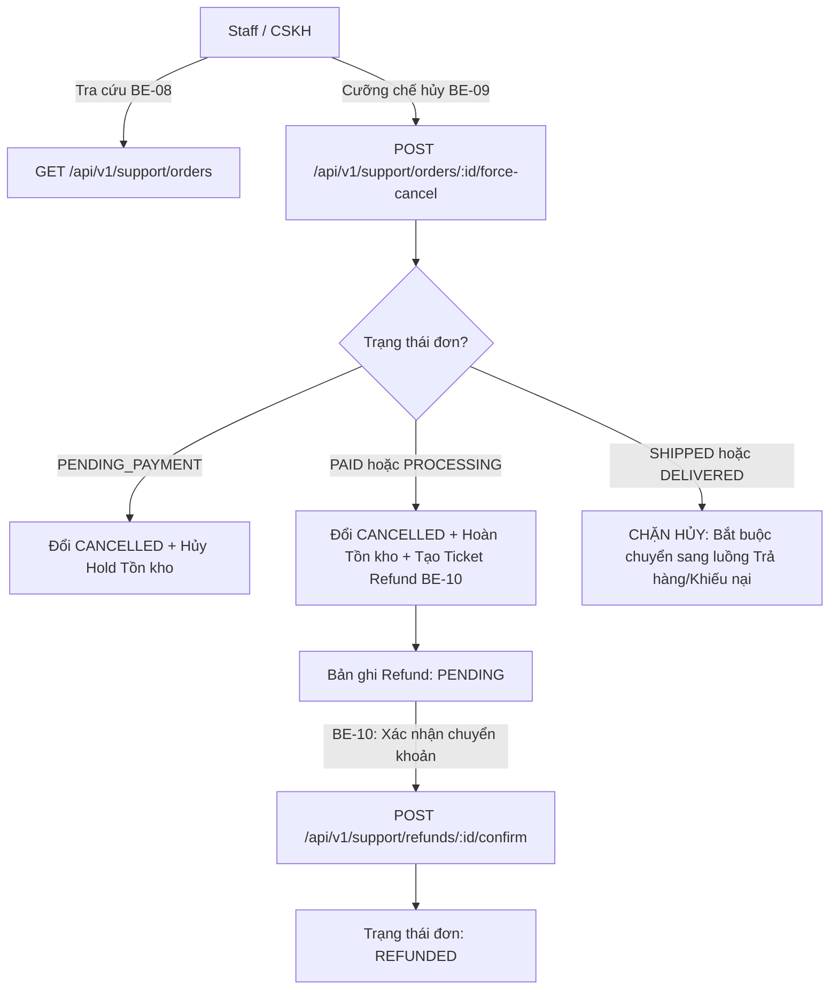

# THIẾT KẾ KỸ THUẬT & GIẢI PHÁP TRIỂN KHAI: BE-08, BE-09, BE-10

## Support Staff Order Management & Refund Workflow Engine

> **Dự án**: Nexus E-Commerce Multi-Vendor Platform  
> **Tác giả**: Lê Minh (Tech Lead)  
> **Tài liệu tham chiếu**: [`docs/BE-08-BE-09-BE-10-readiness.md`](file:///d:/Dev/Learning/NESTJS-SERiES/Nexus-e-commerce/docs/BE-08-BE-09-BE-10-readiness.md) & [`docs/ke-hoach-phan-cong-demo-thu-hai-ghn-va-support-staff.md`](file:///d:/Dev/Learning/NESTJS-SERiES/Nexus-e-commerce/docs/ke-hoach-phan-cong-demo-thu-hai-ghn-va-support-staff.md)  
> **Thời gian áp dụng**: Sprint 3 / Demo thứ Hai (09/11/2026)  
> **Trạng thái**: Approved for Implementation

---

## 1. TỔNG QUAN & BỐI CẢNH

Tài liệu này giải quyết triệt để các câu hỏi và rào cản kỹ thuật được ghi nhận trong file khảo sát mức độ sẵn sàng (`BE-08-BE-09-BE-10-readiness.md`), bao gồm:

1. **BE-08 (95% $\rightarrow$ 100%)**: Chốt format Request/Response DTO tra cứu đơn toàn sàn, giải quyết tách biệt ranh giới module Identity (Bounded Context).
2. **BE-09 (80% $\rightarrow$ 100%)**: Ban hành **Ma trận chính sách hủy đơn đa trạng thái**, đảm bảo tính toàn vẹn tồn kho (Inventory Ledger) và tự động kích hoạt tiến trình hoàn tiền.
3. **BE-10 (75% $\rightarrow$ 100%)**: Định hình kiến trúc **Refund Workflow 2 pha (Two-Phase Hybrid Refund)** giải quyết hạn chế API tự động của PayOS Sandbox, đảm bảo an toàn nghiệp vụ tài chính và chạy demo mượt mà 100%.



---

## 2. CHI TIẾT TASK BE-08: STAFF TRA CỨU ĐƠN HÀNG TOÀN SÀN

### 2.1. Phân quyền & Ranh giới Module (RBAC & Bounded Context)

- **RBAC Guard**: Đòi hỏi Role `STAFF` hoặc `ADMIN`, với permission `ORDER.VIEW_ALL` (hoặc `ORDER.VIEW` kết hợp kiểm tra vai trò nhân viên hỗ trợ).
- **Quy tắc Bounded Context**:
  - Module `Commerce` lưu snapshot địa chỉ người nhận (`recipientName`, `phone`, `street`, `ward`, `district`).
  - Khi cần tìm kiếm hoặc hiển thị thông tin email/tên tài khoản của Buyer (`buyerId`), service **không được query trực tiếp** vào table `identity.users`.
  - Thay vào đó, inject `IdentityApi` (hoặc `UserLookupService`) để enrich thông tin người mua theo batch ID.

### 2.2. Đặc tả API Tra Cứu

#### Endpoint 1: Danh sách đơn hàng toàn sàn

- **Method**: `GET /api/v1/support/orders`
- **Query Parameters (`QuerySupportOrdersDto`)**:
  - `page` (number, default: 1)
  - `limit` (number, default: 20, max: 100)
  - `q` (string, optional): Tìm nhanh theo mã đơn (`orderCode`), số điện thoại nhận hàng (`phone`), hoặc mã vận đơn (`trackingCode`).
  - `buyerEmail` (string, optional): Lọc theo email người mua.
  - `sellerId` (uuid, optional): Lọc theo gian hàng người bán.
  - `status` (enum, optional): `PENDING_PAYMENT`, `PAID`, `PROCESSING`, `SHIPPED`, `DELIVERED`, `CANCELLED`, `REFUNDED`.
  - `fromDate` / `toDate` (ISO Date, optional): Lọc theo thời gian tạo đơn.
- **Response DTO**:
  ```json
  {
    "items": [
      {
        "id": "e6a0c0a2-2321-4f11-8e54-55cf4b598b01",
        "orderNumber": "ORD-20261106-0001",
        "sellerId": "11111111-1111-4111-8111-111111111111",
        "sellerShopName": "Nexus Official Store",
        "buyerId": "99999999-9999-4999-8999-999999999999",
        "buyerEmail": "buyer@example.com",
        "status": "PROCESSING",
        "total": "450000.00",
        "currency": "VND",
        "trackingCode": "GHNABC123XYZ",
        "carrierName": "GHN",
        "recipientName": "Nguyen Van A",
        "recipientPhone": "0987654321",
        "createdAt": "2026-11-06T08:30:00Z"
      }
    ],
    "meta": {
      "currentPage": 1,
      "itemsPerPage": 20,
      "totalItems": 142,
      "totalPages": 8
    }
  }
  ```

#### Endpoint 2: Chi tiết đơn hàng cho Support Staff

- **Method**: `GET /api/v1/support/orders/:id`
- **Response**: Toàn bộ thông tin đơn hàng bao gồm danh sách mặt hàng (`items`), lịch sử chuyển trạng thái (`statusHistory`), thông tin thanh toán PayOS (`paymentTransaction`), thông tin vận chuyển GHN và ghi chú chăm sóc khách hàng.

---

## 3. CHI TIẾT TASK BE-09: STAFF CƯỠNG CHẾ HỦY ĐƠN (ADMIN FORCE CANCEL)

### 3.1. Ma trận chính sách hủy đơn theo trạng thái (Cancellation Matrix)

Để đảm bảo không phát sinh tranh chấp hàng hóa giữa Sàn, Người bán và Đơn vị vận chuyển (GHN), quy định chính sách hủy áp dụng như sau:

| Trạng thái hiện tại          | Cho phép hủy? | Hành động kèm theo                                             | Xử lý tồn kho                                            | Xử lý thanh toán                                                       |
| :--------------------------- | :-----------: | :------------------------------------------------------------- | :------------------------------------------------------- | :--------------------------------------------------------------------- |
| **`PENDING_PAYMENT`**        |     ✅ CÓ     | Hủy đơn bình thường                                            | Giải phóng lượng giữ tồn kho (`releaseReservedQuantity`) | Không có tiền cần hoàn                                                 |
| **`PAID`**                   |     ✅ CÓ     | Hủy đơn + Hoàn tiền                                            | Hoàn trả tồn kho về kho hàng (`refundStockToWarehouse`)  | Tự động sinh yêu cầu Refund (`REFUND_REQUESTED`)                       |
| **`PROCESSING`**             |     ✅ CÓ     | Hủy đơn + Hoàn tiền                                            | Hoàn trả tồn kho về kho hàng                             | Tự động sinh yêu cầu Refund (`REFUND_REQUESTED`)                       |
| **`SHIPPED`**                |  ❌ **CHẶN**  | Hàng đã xuất kho và bàn giao bưu cục GHN. Không thể hủy ngang. | Không thao tác                                           | Phải đợi bưu cục giao hoàn hoặc khách từ chối nhận hàng (Return Flow). |
| **`DELIVERED`**              |  ❌ **CHẶN**  | Hàng đã giao tới tay khách.                                    | Không thao tác                                           | Khách phải gửi yêu cầu "Trả hàng / Hoàn tiền" có đối soát hàng hóa.    |
| **`CANCELLED` / `REFUNDED`** |  ❌ **CHẶN**  | Đơn đã kết thúc vòng đời. Báo lỗi `409 Conflict`.              | Không thao tác                                           | Không thao tác                                                         |

### 3.2. Quy trình xử lý Transaction nguyên tử (ACID Transaction)

Khi Staff thực hiện `POST /api/v1/support/orders/:id/force-cancel`:

1. **Lock Row**: Khóa bi quan (`SELECT ... FOR UPDATE`) dòng đơn hàng trong database.
2. **Kiểm tra điều kiện**: Nếu trạng thái là `SHIPPED`, `DELIVERED`, `CANCELLED` $\rightarrow$ ném `ConflictException` (`CANNOT_CANCEL_ORDER_IN_STATUS`).
3. **Chuyển trạng thái Order State Machine**:
   - Chuyển `toStatus: 'CANCELLED'`
   - Ghi log `reason`: `Staff cưỡng chế hủy: [Lý do do Staff nhập]` kèm `actorId = staffUserId`.
4. **Xử lý tồn kho**:
   - Nếu đơn đang `PENDING_PAYMENT`: Gọi `inventoryReservation.releaseReservedQuantity()`.
   - Nếu đơn đang `PAID` hoặc `PROCESSING`: Gọi `inventoryReservation.releaseHold()`, tăng lại số lượng khả dụng và tạo bản ghi `inventory_ledger` loại `ORDER_CANCEL_RESTOCK`.
5. **Khởi tạo quy trình Refund (nếu có)**:
   - Nếu đơn đã thu tiền (`PAID` hoặc `PROCESSING`): Khởi tạo bản ghi vào bảng `order_refunds` ở trạng thái `REQUESTED`.

---

## 4. CHI TIẾT TASK BE-10: QUY TRÌNH & KIẾN TRÚC HOÀN TIỀN (REFUND WORKFLOW)

### 4.1. Giải pháp cho cổng thanh toán PayOS Sandbox

- **Đặc thù PayOS**: Sandbox của PayOS hiện hỗ trợ rất mạnh tính năng **Thu tiền qua VietQR** (`createPaymentLink` + Webhook). Tuy nhiên, API **Hoàn tiền tự động trực tiếp từ số dư tài khoản ảo** yêu cầu hợp đồng Payout API doanh nghiệp có ký quỹ.
- **Giải pháp Hybrid (Phù hợp 100% cho Demo & Sẵn sàng cho Production)**:
  1. **Bước 1 (Tạo yêu cầu hoàn tiền)**: Khi Staff hủy đơn (ở BE-09), hệ thống tự động sinh 1 yêu cầu Refund với thông tin số tiền cần hoàn, mã giao dịch PayOS gốc.
  2. **Bước 2 (Duyệt & Chuyển khoản thực tế)**:
     - Nhân viên tài chính/kế toán kiểm tra danh sách `GET /api/v1/support/refunds?status=REQUESTED`.
     - Nhân viên đối soát tài khoản và thực hiện chuyển khoản lại cho khách qua ngân hàng.
     - Gọi endpoint: `POST /api/v1/support/refunds/:id/confirm-transferred` kèm số tham chiếu giao dịch ngân hàng (`bankReferenceCode`).
  3. **Bước 3 (Chốt sổ)**: Đơn hàng cập nhật trạng thái `REFUNDED`.

### 4.2. Thiết kế CSDL: Bảng `commerce.order_refunds`

```sql
CREATE TABLE IF NOT EXISTS commerce.order_refunds (
    id UUID PRIMARY KEY DEFAULT gen_random_uuid(),
    order_id UUID NOT NULL REFERENCES commerce.orders(id) ON DELETE RESTRICT,
    refund_code VARCHAR(64) UNIQUE NOT NULL,            -- Ví dụ: REF-ORD20261106-0001
    amount NUMERIC(18, 2) NOT NULL,
    currency VARCHAR(3) NOT NULL DEFAULT 'VND',
    reason VARCHAR(500) NOT NULL,
    status VARCHAR(32) NOT NULL DEFAULT 'REQUESTED',    -- REQUESTED, PROCESSING, COMPLETED, REJECTED
    payment_carrier VARCHAR(32) DEFAULT 'PAYOS',        -- Cổng thanh toán gốc
    original_transaction_ref VARCHAR(100),              -- Mã giao dịch gốc PayOS
    bank_reference_code VARCHAR(100),                   -- Mã giao dịch ngân hàng khi chuyển khoản hoàn tiền
    requested_by UUID NOT NULL,                         -- Staff ID tạo lệnh
    processed_by UUID,                                  -- Staff ID duyệt / thực hiện
    processed_at TIMESTAMPTZ,
    notes TEXT,
    created_at TIMESTAMPTZ NOT NULL DEFAULT NOW(),
    updated_at TIMESTAMPTZ NOT NULL DEFAULT NOW()
);

CREATE INDEX idx_order_refunds_order_id ON commerce.order_refunds(order_id);
CREATE INDEX idx_order_refunds_status ON commerce.order_refunds(status);
```

### 4.3. Đặc tả API Quản lý Hoàn Tiền

#### 1. Danh sách yêu cầu hoàn tiền

- `GET /api/v1/support/refunds`
- Query: `status`, `page`, `limit`.

#### 2. Xác nhận đã hoàn tiền thành công

- `POST /api/v1/support/refunds/:id/confirm-transferred`
- **Body**:
  ```json
  {
    "bankReferenceCode": "FT26310123456789",
    "notes": "Đã chuyển hoàn 450.000đ về STK MBBank của khách hàng qua Napas 24/7"
  }
  ```
- **Hành vi**:
  - Chuyển trạng thái Refund: `COMPLETED`.
  - Chuyển trạng thái Order: `REFUNDED` thông qua `OrderStateMachine`.
  - Ghi nhật ký trạng thái đơn hàng (`order_status_history`).

---

## 5. BẢNG PHÂN CÔNG & CHECKLIST TRIỂN KHAI

| Hạng mục                   | Người phụ trách      | File cần tạo / chỉnh sửa                                                                                                                                                                    | Hạn hoàn thành       |
| :------------------------- | :------------------- | :------------------------------------------------------------------------------------------------------------------------------------------------------------------------------------------ | :------------------- |
| **BE-08: Query toàn sàn**  | **Đạt (Backend)**    | `src/modules/commerce/controllers/support-order.controller.ts`<br>`src/modules/commerce/services/support-order.service.ts`<br>`src/modules/commerce/dtos/query-support-orders.dto.ts`       | **Thứ Bảy (07/11)**  |
| **BE-09: Cưỡng chế hủy**   | **Hoàng (Backend)**  | `src/modules/commerce/services/order-cancel.service.ts`<br>`src/modules/commerce/dtos/force-cancel-order.dto.ts`<br>`order.service.ts`                                                      | **Thứ Bảy (07/11)**  |
| **BE-10: Refund Workflow** | **Tuấn (Backend)**   | `src/modules/commerce/domain/entities/order-refund.entity.ts`<br>`src/modules/commerce/services/order-refund.service.ts`<br>`src/modules/commerce/controllers/support-refund.controller.ts` | **Chủ Nhật (08/11)** |
| **Review & Integration**   | **Minh (Tech Lead)** | Chạy TypeCheck, Lint, Vitest toàn diện, Test E2E kết nối GHN + PayOS + Staff                                                                                                                | **Chủ Nhật (08/11)** |

---

## 6. TIÊU CHUẨN NGHIỆM THU (ACCEPTANCE CRITERIA)

1. **BE-08**:
   - Staff tìm kiếm được đơn hàng theo bất kỳ tiêu chí nào (Mã đơn, SĐT, Trạng thái) trong thời gian dưới 200ms.
   - Không bị vỡ dữ liệu khi khách hàng chưa cập nhật số điện thoại hoặc email.
2. **BE-09**:
   - Đơn ở trạng thái `SHIPPED` hoặc `DELIVERED` khi gọi hủy sẽ nhận mã lỗi `409 Conflict` với thông báo tiếng Việt rõ ràng.
   - Số lượng sản phẩm tồn kho trong kho hàng được hoàn lại chính xác theo đúng số lượng đơn bị hủy.
3. **BE-10**:
   - Khi đơn `PAID` bị hủy, bảng `order_refunds` có đúng 1 bản ghi mới ở trạng thái `REQUESTED`.
   - Khi Staff bấm xác nhận chuyển khoản hoàn tiền, đơn hàng chính thức đổi sang trạng thái `REFUNDED` và không thể hủy tiếp.
