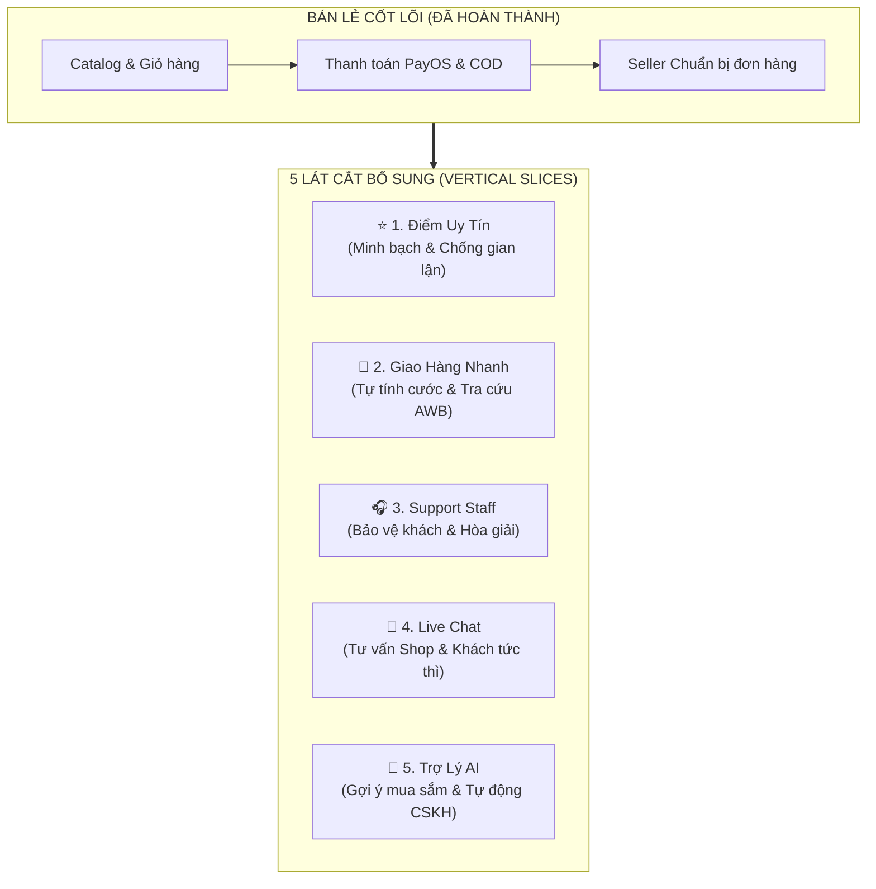

# TỔNG QUAN KẾ HOẠCH TRIỂN KHAI VERTICAL SLICES (BẢN TỔNG HỢP NGHIỆP VỤ)

## DỰ ÁN: NEXUS E-COMMERCE & REALTIME AUCTION PLATFORM

### (ĐIỂM UY TÍN • GIAO HÀNG TỰ ĐỘNG • SUPPORT STAFF • LIVE CHAT • TRỢ LÝ AI)

> **Mục đích tài liệu:** Bản tóm tắt tổng quan dành cho Quản lý dự án (PM/PO), Giảng viên, Hội đồng phản biện và các thành viên nhóm nắm bắt nhanh bức tranh toàn cảnh, giá trị nghiệp vụ và lộ trình triển khai mà không đi quá sâu vào code kỹ thuật.  
> **Tài liệu kỹ thuật chuyên sâu:** Chi tiết code DDL, DTO và API xem tại [`docs/ke-hoach-vertical-slices-shipping-staff-reputation-ai-chat.md`](file:///d:/Dev/Learning/NESTJS-SERiES/Nexus-e-commerce/docs/ke-hoach-vertical-slices-shipping-staff-reputation-ai-chat.md).

---

## 🎯 1. BỐI CẢNH & MỤC TIÊU DỰ ÁN

Hiện tại, hệ thống Nexus đã hoàn thiện nền tảng mua sắm bán lẻ cốt lõi: Đăng nhập/Đăng ký (đã bỏ captcha bắt buộc), Duyệt sản phẩm 3 cấp danh mục, Giỏ hàng, Thanh toán trực tuyến PayOS, Kênh người bán (Seller Hub) và Kênh quản trị (Admin Console).

Để nền tảng trở thành **một sàn thương mại điện tử hoàn chỉnh, vận hành an toàn và có tính cạnh tranh cao**, dự án cần bổ sung **5 Lát cắt nghiệp vụ dọc (Vertical Slices)**:

---

## 🧩 2. Ý NGHĨA & GIÁ TRỊ CỦA 5 VERTICAL SLICES

### ⭐ Lát cắt 1: Động Cơ Điểm Uy Tín & Đánh Giá 2 Chiều (Reputation & Trust Level)

- **Ý nghĩa:** Giải quyết bài toán lớn nhất của thương mại điện tử và đấu giá: **Lòng tin (Trust)**. Ngăn chặn tình trạng bùng hàng, bom hàng hoặc gian lận đấu giá.
- **Quy tắc chính:**
  - Điểm số từ **0 đến 100 điểm** (Tài khoản mới bắt đầu từ **50 điểm**).
  - **5 Hạng uy tín:**
    - 🥇 **VIP (90 - 100đ):** Khách hàng thân thiết, miễn cọc đấu giá, hỗ trợ 24/7.
    - 🥈 **TRUSTED (80 - 89đ):** Độ uy tín cao, tham gia mọi phiên đấu giá.
    - 🥉 **STANDARD (50 - 79đ):** Tài khoản tiêu chuẩn mua sắm bình thường.
    - ⚠️ **RESTRICTED (30 - 49đ):** Bị hạn chế giá trị đấu giá, bắt buộc đặt cọc trước 20%.
    - 🚫 **UNTRUSTED (0 - 29đ):** Cấm hoàn toàn tham gia đấu giá, chỉ được mua hàng thanh toán trước.
  - **Thưởng & Phạt minh bạch:** Mua hàng thành công (+1đ), trả tiền đấu giá đúng hạn (+3đ); tự ý hủy đơn (-5đ), bùng kèo đấu giá quá 48h (-30đ và cấm đấu giá 7 ngày).
  - **Đánh giá 2 chiều:** Buyer và Seller có 14 ngày để đánh giá sao và nhận xét lẫn nhau sau khi đơn hàng hoàn tất.

---

### 🚚 Lát cắt 2: Giao Hàng Nhanh Tự Động (Logistics Integration - GHN Express)

- **Ý nghĩa:** Khép kín quy trình giao vận thực tế, không để Seller phải tự gõ tay đơn vị vận chuyển thủ công.
- **Trải nghiệm người dùng:**
  - **Người mua:** Khi chọn địa chỉ nhận hàng (Tỉnh/Thành $\rightarrow$ Quận/Huyện $\rightarrow$ Phường/Xã), hệ thống tự động kết nối bưu cục GHN tính cước phí chính xác theo khoảng cách và cân nặng.
  - **Người bán:** Khi bấm _"Giao hàng"_, hệ thống tự động sinh mã vận đơn bưu cục thật (AWB) và cấp phiếu in mã vạch dán lên kiện hàng.
  - **Tra cứu hành trình:** Theo dõi tiến độ giao hàng trực quan trên web: Đang lấy hàng $\rightarrow$ Đang trung chuyển $\rightarrow$ Đang giao $\rightarrow$ Giao thành công.

---

### 🎧 Lát cắt 3: Phân Hệ Nhân Viên Hỗ Trợ & Giải Quyết Khiếu Nại (Support Staff & Dispute Desk)

- **Ý nghĩa:** Cung cấp cổng làm việc chuyên nghiệp cho đội ngũ CSKH để giải quyết các sự cố đơn hàng và bảo vệ quyền lợi người tiêu dùng.
- **Các tính năng nổi bật:**
  - **Tra cứu đơn toàn diện:** Tìm kiếm đơn hàng của bất kỳ ai bằng mã đơn `ORD-xxx`, email hoặc số điện thoại.
  - **Can thiệp đơn hàng:** Hỗ trợ hủy đơn hộ khách và hoàn tiền tự động khi đơn hàng gặp sự cố giao vận.
  - **Cổng Hòa giải Tranh chấp (Ký quỹ 72h):**
    - Sau khi nhận hàng, khách có 72 giờ để bấm _"Khiếu nại / Đổi trả"_ nếu hàng vỡ hoặc sai mô tả.
    - Trong 72 giờ này, tiền thanh toán được tạm giữ an toàn trong ví ký quỹ của sàn.
    - Nhân viên Support xem bằng chứng ảnh/video của hai bên để phán quyết: Hoàn tiền cho Buyer hoặc Giải ngân cho Shop.

---

### 💬 Lát cắt 4: Hệ Thống Chat Box Hỗ Trợ Trực Tuyến (Realtime Live Chat)

- **Ý nghĩa:** Tăng tỷ lệ chốt đơn và giữ chân khách hàng thông qua tương tác thời gian thực tức thì.
- **Các luồng giao tiếp:**
  - **Khách hàng $\leftrightarrow$ Cửa hàng (Buyer - Seller Chat):** Khách nhắn tin trực tiếp trên trang sản phẩm để hỏi tư vấn kích thước, màu sắc, tình trạng còn hàng trước khi mua.
  - **Khách hàng $\leftrightarrow$ Nhân viên CSKH (Support Live Chat):** Hỗ trợ xử lý thắc mắc tài khoản hoặc sự cố thanh toán.
  - Cửa sổ chat dạng bong bóng nổi (Floating Widget) tiện lợi ở góc phải màn hình, hỗ trợ gửi kèm ảnh chụp sản phẩm.

---

### 🤖 Lát cắt 5: Ứng Dụng Trí Tuệ Nhân Tạo (Gemini AI Smart Assistant)

- **Ý nghĩa:** Tạo điểm nhấn công nghệ đột phá (USP) cho sàn Nexus, mang lại trải nghiệm mua sắm hiện đại chuẩn quốc tế.
- **3 Tính năng AI then chốt:**
  1. **Trợ lý mua sắm AI (Shopping Assistant):** Khách hàng chỉ cần gõ nhu cầu: _"Tìm giúp tôi áo sơ mi trắng nam dưới 300k để đi phỏng vấn"_, AI sẽ tự động lọc kho hàng và trả về đúng sản phẩm phù hợp.
  2. **Tra cứu & Hỏi đáp tự động 24/7:** AI giải đáp tức thì các chính sách đổi trả, thời gian giao hàng hoặc tra cứu lộ trình đơn hàng `ORD-xxx` mà không cần chờ nhân viên trực.
  3. **Chuyển giao thông minh (AI-to-Human Handover):** Khi AI nhận thấy khách hàng đang bức xúc hoặc có yêu cầu khiếu nại nghiêm trọng, bot sẽ tự động chuyển cuộc trò chuyện sang nhân viên CSKH đang online.

---

## 👥 3. PHÂN BỔ NHIỆM VỤ & LỘ TRÌNH TRIỂN KHAI

Kế hoạch được tổ chức thành **2 Đợt (mỗi đợt 1 tuần)** chia đều cho 4 thành viên theo phương pháp Vertical Slicing:

| Thành viên           | Trọng tâm Phụ trách         |   Lát cắt đảm nhiệm   | Kết quả bàn giao (Deliverables)                                                                      |
| -------------------- | --------------------------- | :-------------------: | ---------------------------------------------------------------------------------------------------- |
| **Minh (Tech Lead)** | Kiến trúc Trust & AI Engine | **Slice 1 + Slice 5** | • Hệ thống Điểm uy tín & Đánh giá 2 chiều • Tích hợp Google Gemini Assistant & Function Calling  |
| **Khoa**             | Tích hợp Giao vận Bưu cục   |      **Slice 2**      | • Kết nối API GHN Express Sandbox • Tính cước phí động & Webhook tự cập nhật hành trình          |
| **Hoàng**            | Cổng Vận hành CSKH          |      **Slice 3**      | • Giao diện Support Desk tra cứu đơn toàn sàn • Luồng giải quyết khiếu nại tranh chấp ký quỹ 72h |
| **Duy**              | Giao tiếp Thời gian thực    |      **Slice 4**      | • Cổng kết nối Socket.IO Livechat • Widget Chatbox nổi phía Buyer & Hộp thư đến của Shop         |

---

## 🏁 4. TIÊU CHUẨN ĐỊNH NGHĨA HOÀN THÀNH (DEFINITION OF DONE - DOD)

Mọi lát cắt khi hoàn thành phải thỏa mãn 4 tiêu chí cốt lõi:

1. **Hoạt động trọn vẹn (End-to-End):** Tính năng chạy xuyên suốt từ giao diện người dùng (Frontend React) $\rightarrow$ Backend NestJS $\rightarrow$ Cơ sở dữ liệu PostgreSQL.
2. **Kiểm thử tự động:** Unit test và Integration test pass 100%, không có lỗi TypeScript (`npm run typecheck`) và Lint (`npm run lint`).
3. **Bảo mật phân quyền:** Đúng người đúng việc (Khách không xem được chat người khác, Seller chỉ quản lý đơn của mình, Staff có quyền can thiệp theo quy định).
4. **Trải nghiệm mượt mà:** Giao diện trực quan, có thông báo trạng thái rõ ràng, tốc độ phản hồi nhanh.
